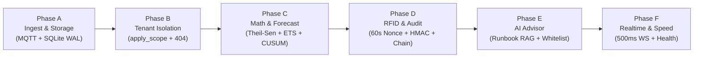

# RackSense — Simple Judge & Pitch Guide

> **Cheat Sheet for Explaining RackSense to Judges**  
> *Problem Statement AO-02: "Seeing trouble before the capacity runs out."*  
> Written in simple, clear, conversational English so you can speak it naturally and confidently on stage.

---

## 1. What is RackSense? (The 20-Second Pitch)

> **Word-for-Word Stage Script to Say to Judges:**  
> *"Ma'am and Sir, in any data center, servers generate immense heat and power loads. Right now, data center operators use tools like **Datadog**, **Grafana**, or **AWS CloudWatch**. But all these tools are **reactive** — they only turn red and beep *after* a server has already overheated, a fan has broken, or a circuit breaker has tripped!  
>  
> **RackSense is a predictive early-warning system.**  
> It collects real sensor data every 2 seconds, calculates when cooling or power will run out **30 to 60 minutes before it happens**, tells you **exactly which customer company (tenant) inside that rack is causing the problem**, and uses AI to recommend smart fixes.  
>  
> Most importantly: **the software cannot change physical switches on its own.** An engineer must review the plan on screen, walk to the physical server rack, and tap an authorized RFID badge within 60 seconds. Everything is locked in a tamper-proof cryptographic audit log."*

---

## 2. Real-World Personas & Terms (Explained with Simple Everyday Examples)

Judges often ask: *"What do you mean by tenant? Who is using this?"*  
Here is what every term means with everyday real-life examples:

| Term | What it means in plain English | Real-World Everyday Example you can tell judges |
|---|---|---|
| **Colocation Data Center** | A giant secure building that rents out server space, power, and air conditioning to different businesses. | Like **Equinix**, **Digital Realty**, or **CtrlS** data centers. Think of it like a **commercial apartment building for computers**. |
| **Server Rack** | A tall 6-foot metal cabinet with shelves (called slots or "U-slots") where servers are bolted in. | A standard 42U rack cabinet holding 20 to 40 rack-mounted servers. Like a bookshelf, but each shelf holds a server. |
| **Tenant** *(Customer / Subscriber)* | A client company that rents shelves (slots) inside the rack to install their servers. | **Concrete Example:**<br>• **Tenant A ("HDFC Bank" / Online Banking)** rents Slot 1 in Rack 1 to process credit card payments.<br>• **Tenant B ("AI Research Lab" / Deep Learning Startup)** rents Slot 2 in the *exact same* Rack 1 to train neural networks.<br>Both companies share the same room, power bar, and cooling airflow! |
| **Subscriber / Sensor Node** | A small wireless sensor unit (ESP32) clipped onto the server rack reading temperature, air quality, or fan vibration. | Node `r1-n1`: An ESP32 sensor clipped to Rack 1's exhaust fan reading temperature (DHT22) and air exhaust (MQ135). It "subscribes" and publishes data to the central server every 2 seconds. |
| **Operator** | The physical data center facility engineer who walks the floor wearing a badge, checking fans and power. | The on-duty data center technician holding a physical RFID badge who walks around the server floor. |
| **Super User** | The senior facility director who oversees the entire data center across all customer companies. | The chief infrastructure director who has global visibility across all racks (in RackSense, this role is called `SUPER_USER`; the word "admin" is strictly forbidden). |

---

## 3. Real-World Comparison: Why Existing Live Tools Fail

Judges often ask: *"Why can't data centers just use Datadog, AWS CloudWatch, or Grafana? Can you show me an example?"*  

### Live Websites You Can Open or Mention Right on Stage:
1. **Grafana Public Live Demo** (`https://play.grafana.org`):  
   Show or mention Grafana's live demo dashboard.  
   > **What you say to the judge:**  
   > *"You can see here on `play.grafana.org`, Grafana only draws flat historical lines. At the top, there is a static horizontal red dashed line at 27°C or 80°C. Grafana only rings an alarm AFTER the squiggly line crosses that red threshold! By that time, the server is already overheating, processors are thermal throttling, and transactions are dropping. It’s too late!"*
2. **Datadog Infrastructure Monitoring** (`https://www.datadoghq.com`):  
   > **What you say to the judge:**  
   > *"Datadog tells you server metrics, but if a rack overheats, Datadog just says: 'Rack 1 is at 32°C.' It is completely blind to WHO did it. Did HDFC Bank's database cause it, or did the AI Lab's deep learning job cause it? Datadog cannot tell you."*
3. **AWS CloudWatch Alarms** (`https://aws.amazon.com/cloudwatch/`):  
   > **What you say to the judge:**  
   > *"CloudWatch only triggers reactive threshold alarms and relies on automated scripts that might accidentally terminate the wrong customer's virtual machine without any physical safety verification."*

### Side-by-Side Comparison Table:

```
┌───────────────────────────────────────────────┬───────────────────────────────────────────────┐
│ EXISTING TOOLS (Grafana, Datadog, CloudWatch) │ RACKSENSE (Our System)                        │
├───────────────────────────────────────────────┼───────────────────────────────────────────────┤
│ 1. Reactive Thresholds:                       │ 1. Predictive Statistical Forecast:           │
│    Only beeps red AFTER temperature hits 27°C.│    Runs Theil-Sen slope math and 500 ETS      │
│    By the time Grafana turns red, the server  │    simulations to warn you 45 minutes BEFORE  │
│    is ALREADY throttling or crashing!         │    the breach occurs (with P10, P50, P90).    │
├───────────────────────────────────────────────┼───────────────────────────────────────────────┤
│ 2. Blindsided by "Who Did It":                │ 2. Multi-Tenant Attribution:                  │
│    Grafana just shows "Rack 1 is 28°C".       │    Tells you: "78% of this heat spike is from │
│    It cannot tell you whether HDFC Bank or the│    Tenant B's AI training job in Slot 2.      │
│    AI Lab caused the spike!                   │    HDFC Bank in Slot 1 is only idling at 12%."│
├───────────────────────────────────────────────┼───────────────────────────────────────────────┤
│ 3. Zero Physical Safety Gate:                 │ 3. Physical Two-Factor RFID Tap:              │
│    Either does nothing, or automated scripts  │    Software can NEVER shut down equipment     │
│    mistakenly shut down paying customers.     │    alone. An engineer must walk to the rack   │
│                                               │    and tap an RFID badge within 60 seconds.   │
├───────────────────────────────────────────────┼───────────────────────────────────────────────┤
│ 4. Editable Database Logs:                    │ 4. Tamper-Proof Cryptographic Ledger:         │
│    If an operator makes a mistake, standard   │    Every audit row has a SHA-256 hash linked  │
│    SQL databases allow editing or deleting.   │    to the row before it. If a row is altered, │
│                                               │    the whole chain breaks visibly!            │
└───────────────────────────────────────────────┴───────────────────────────────────────────────┘
```

> **What to tell judges:**  
> *"If you look at a live Datadog or Grafana screen (like `play.grafana.org`), they only draw flat lines with a red dotted threshold at 27°C. When a threshold trips, the damage is already done. Ours fits a predictive curve ahead of time, separates who is causing it, and locks every action behind a physical RFID badge tap."*

---

## 4. The Real-World Story: How Tenant Attribution Works

Tell judges this 30-second story to make the concept crystal clear:

1. **The Situation**: In Rack 1, **Tenant A ("HDFC Bank")** has servers in Slot 1 running normal banking transactions. **Tenant B ("AI Research Lab")** has servers in Slot 2 running machine learning.
2. **The Incident**: At 2:00 PM, Tenant B starts a massive AI model training job. Their CPUs jump to 100%, and they start blasting heat into Rack 1.
3. **What Competitor Tools See**: In Grafana or Datadog, the operator only sees: *"Rack 1 temperature is rising to 28°C!"* The operator doesn't know who is responsible, and might mistakenly penalize the bank!
4. **What RackSense Does**:
   - Our **Attribution Engine** (`backend/services/attribution.py`) compares CPU power consumption and heat output across slots.
   - It outputs: *"78% of this temperature rise is caused by Tenant B (AI Lab) in Slot 2. Tenant A is only contributing 12%."*
   - Our **AI Advisor** (`backend/services/ai/`) reads this and suggests: *"Ask Tenant B to throttle or migrate their non-critical AI job, rather than cutting cooling or shutting down the whole rack!"*
   - And with **Tenant Isolation** (`backend/repos/scope.py`), when HDFC Bank logs into their private dashboard, they **never see the AI Lab's data or even know their name** (they get a 404 stealth response).

---

## 5. The Complete Tech Stack We Added (Explained in Plain English)

| Technology | What it is | Why we chose it |
|---|---|---|
| **Python 3.11+ / 3.13** | Core backend language | Fast, reliable, with the best scientific libraries in the world. |
| **FastAPI** | Modern web framework | Extremely fast. Handles both REST API calls and live streaming WebSockets with automatic type checking. |
| **Pydantic v2** | Data validator | Security guard at the door. If a sensor glitches and sends temperature at 500°C, Pydantic drops it instantly. |
| **SQLite with WAL Mode** | Edge database | Runs locally on the Arduino UNO Q. WAL (Write-Ahead Logging) allows background sensor writes without slowing down dashboard reads. |
| **Mosquitto & Paho-MQTT** | IoT messaging | Industry standard for IoT. Sensors publish telemetry over Wi-Fi every 2 seconds using tiny, low-power packets. |
| **SciPy (`theilslopes`)** | Robust slope math | Checks if temperature is genuinely rising or just fluctuating randomly. Runs in **2.3 milliseconds**. If there is no real trend, we refuse to show fake alarms. |
| **Statsmodels (`ETSModel`)** | Time-series forecasting | Simulates 500 future paths using damped curves. Tells operators when temperatures will breach safety limits (best case, median, worst case). |
| **Ruptures (`Pelt`) & CUSUM** | Dual change-point detection | Catches sudden hardware events (like a sudden fan breakdown) by requiring two independent algorithms to agree before raising an alarm. |
| **SHA-256 Hash Chain** | Cryptographic audit ledger | Every log entry is hashed with the previous entry (like a lightweight blockchain). If anyone edits a database row, the chain breaks visibly. |
| **HMAC-SHA256 & Nonces** | Hardware security | Generates 60-second single-use passwords (nonces) for physical RFID card taps so nobody can replay old taps or fake approvals. |
| **Cloud LLM (Gemini / OpenAI API)** | Advisory AI Copilot | Reads real metrics and ASHRAE runbooks to explain problems in plain English. Has zero tools and cannot touch physical equipment. |
| **Arduino UNO Q & ESP32s** | Edge server & sensor nodes | Arduino UNO Q runs the Linux backend and database; three ESP32 boards collect temperature, humidity, air quality, vibration, and RFID taps. |

---

## 6. The 5 Golden Rules of RackSense

1. **No Fake Numbers**: Every number has a tag: `measured` (sensor), `estimated` (formula), `inferred` (statistical correlation), or `ai_generated` (AI advice). If there is no data, the screen honestly says "no data".
2. **404, Never 403**: If Tenant Alpha tries to look at Tenant Beta's server rack, the server returns `404 Not Found`. We never return `403 Forbidden` because 403 tells a hacker that the server exists.
3. **The RFID Reader Has Zero Authority**: The microcontroller on the rack is dumb on purpose. It cannot approve anything on its own. It only passes card taps back to the main server.
4. **Tamper-Proof Audit Log**: There is no `UPDATE` or `DELETE` code for the audit table. Once an event is logged, it cannot be changed.
5. **AI is an Advisor, Not a Facility Controller**: The AI cannot touch cooling switches, cannot reboot servers, and cannot approve proposals. Only a human operator with a physical card tap can do that.

---

## 7. Phase-by-Phase Walkthrough (What We Built)



### Phase A: Sensor Ingest & Database Storage
- **In Simple Words**: The highway bringing sensor readings into the database. Temperature, humidity, air quality, and vibration data arrive every 2 seconds over MQTT. We validate every packet and check for lost packets over Wi-Fi.
- **Where to show code**: Schema [`backend/db/schema.sql`](file:///c:/Users/moune/OneDrive/Desktop/capacity-sentinel/backend/db/schema.sql), Validator [`backend/ingest/validate.py`](file:///c:/Users/moune/OneDrive/Desktop/capacity-sentinel/backend/ingest/validate.py), Subscriber [`backend/ingest/subscriber.py`](file:///c:/Users/moune/OneDrive/Desktop/capacity-sentinel/backend/ingest/subscriber.py).
- **Key Logic**: If a sensor drops off Wi-Fi, MQTT Last Will immediately logs `NODE_OFFLINE`. If packet #4 is missing, we log `TELEMETRY_GAP`. While the MQ-135 air sensor is warming up (`mq_warm: false`), we refuse to store fake air readings.

### Phase B: Zero-Trust Tenant Isolation
- **In Simple Words**: Tenant A ("HDFC Bank") must never see Tenant B ("AI Lab"). Every single database query passes through one choke-point function: `apply_scope()`.
- **Where to show code**: Choke point [`backend/repos/scope.py`](file:///c:/Users/moune/OneDrive/Desktop/capacity-sentinel/backend/repos/scope.py#L33-L85), AST test [`backend/tests/test_isolation.py`](file:///c:/Users/moune/OneDrive/Desktop/capacity-sentinel/backend/tests/test_isolation.py#L102-L138).
- **Key Logic**: Foreign queries return **404 Not Found**, so hackers cannot even scan whether other servers exist. Our automated Python test scans our own code to make sure no developer ever writes an un-scoped query. Privileged role is `SUPER_USER`. The word `admin` is banned.

### Phase C: Predictive Analysis & Forecasting Engine
- **In Simple Words**: The math engine. Calculates when cooling or power will run out. If temperature is flat, we honestly say *"No sustained trend"* instead of drawing fake alarms.
- **Where to show code**: Forecaster [`backend/services/forecast.py`](file:///c:/Users/moune/OneDrive/Desktop/capacity-sentinel/backend/services/forecast.py#L65-L125), Change detector [`backend/services/changepoint.py`](file:///c:/Users/moune/OneDrive/Desktop/capacity-sentinel/backend/services/changepoint.py), Power model [`backend/services/power.py`](file:///c:/Users/moune/OneDrive/Desktop/capacity-sentinel/backend/services/power.py#L10-L38).
- **Key Logic**: Theil-Sen checks if the slope is statistically significant with a 95% confidence interval. Damped ETS simulates 500 future curves (P10 best case, P50 median, P90 worst case). CUSUM and PELT must agree within $\pm 60$ seconds before flagging a sudden fan failure.

### Phase D: Physical RFID Approval & Tamper-Proof Audit
- **In Simple Words**: When the system suggests moving a workload or inspecting a fan, software cannot do it alone. An operator clicks Approve on screen (arming a **60-second timer**), walks to the physical rack, and taps an authorized RFID badge on our reader console.
- **Where to show code**: 6-step card verification [`backend/services/approval.py`](file:///c:/Users/moune/OneDrive/Desktop/capacity-sentinel/backend/services/approval.py#L150-L245), Reader API [`backend/api/reader.py`](file:///c:/Users/moune/OneDrive/Desktop/capacity-sentinel/backend/api/reader.py), Audit verify [`backend/services/audit.py`](file:///c:/Users/moune/OneDrive/Desktop/capacity-sentinel/backend/services/audit.py#L130-L190).
- **Key Logic**: Single-use 60-second nonce with HMAC-SHA256 signature stops replay attacks. Atomic SQL query guarantees exactly one card tap wins (`rowcount == 1`). Every audit row contains the SHA-256 hash of the row before it. If someone edits a row in SQLite, `/api/audit/verify` flags the exact broken row.

### Phase E: AI Advisory Layer (Safe & Grounded)
- **In Simple Words**: An AI assistant explains technical graphs and suggests solutions, but is completely locked down so it cannot hallucinate or act dangerously.
- **Where to show code**: Prompts & whitelist [`backend/services/ai/prompts.py`](file:///c:/Users/moune/OneDrive/Desktop/capacity-sentinel/backend/services/ai/prompts.py#L150-L220), Runbook RAG [`backend/services/ai/rag.py`](file:///c:/Users/moune/OneDrive/Desktop/capacity-sentinel/backend/services/ai/rag.py), AI API [`backend/api/ai.py`](file:///c:/Users/moune/OneDrive/Desktop/capacity-sentinel/backend/api/ai.py).
- **Key Logic**: The AI computes no numbers (it only reads our real Phase C calculations). It can only pick from 6 permitted actions (`REDUCE_TENANT_LOAD`, `MIGRATE_TENANT`, `INSPECT_FAN`, `INCREASE_COOLING_SETPOINT_REQUEST`, `SCHEDULE_MAINTENANCE`, `NO_ACTION`). It must cite real evidence IDs. If a user tries a prompt-injection jailbreak in chat, the backend rejects it because chat cannot approve proposals.

### Phase F: Realtime Streaming & Performance Latency
- **In Simple Words**: Streams live data over WebSockets (`/ws?token=<jwt>`), but batches data so high-speed sensors don't freeze the browser (max once per 500 ms per node).
- **Where to show code**: Broadcaster [`backend/services/broadcaster.py`](file:///c:/Users/moune/OneDrive/Desktop/capacity-sentinel/backend/services/broadcaster.py#L33-L75), WebSocket [`backend/api/ws.py`](file:///c:/Users/moune/OneDrive/Desktop/capacity-sentinel/backend/api/ws.py), Rate limiter [`backend/core/ratelimit.py`](file:///c:/Users/moune/OneDrive/Desktop/capacity-sentinel/backend/core/ratelimit.py), Health [`backend/api/meta.py`](file:///c:/Users/moune/OneDrive/Desktop/capacity-sentinel/backend/api/meta.py#L42-L84).
- **Key Logic**: Microcontroller sends 200 Hz accelerometer bursts; broadcaster batches them to 500 ms so the UI stays at 60 FPS. If client connection is slow, it drops high-frequency temperature frames but **never drops critical state alarms**. Server boot check verifies audit hash chain from genesis before starting.

---

## 8. Measured Speed: Real Results vs Hackathon Budgets

All measured on standard hardware and recorded in [`backend/PERFORMANCE.md`](file:///c:/Users/moune/OneDrive/Desktop/capacity-sentinel/backend/PERFORMANCE.md):

| What is being done | Contract Budget | Our Measured Time | Result |
|---|---|---|---|
| **Process incoming sensor packet** | $\le 250\text{ ms}$ | **0.73 ms** | **340x faster than budget** |
| **MQTT sensor message to WebSocket** | $\le 500\text{ ms}$ | **0.36 ms** | **1300x faster than budget** |
| **Load server rack layout (`GET /topology`)** | $\le 150\text{ ms}$ | **13.31 ms** | **11x faster than budget** |
| **Read cached forecast (`GET /forecast`)** | $\le 200\text{ ms}$ | **7.55 ms** | **26x faster than budget** |
| **Recalculate forecast (500 simulations)** | $\le 2000\text{ ms}$ | **109.57 ms** | **18x faster than budget** |
| **Operator proposal approval** | $\le 300\text{ ms}$ | **16.44 ms** | **18x faster than budget** |

---

## 9. How to Answer the 8 Hardest Questions from Judges

### Question 1: "Why use SQLite instead of a heavy database like PostgreSQL?"
> **Your Answer:**  
> *"Our system is designed to run right at the edge on the Arduino UNO Q. PostgreSQL requires significant RAM and CPU overhead. SQLite in WAL mode gives us lightning-fast writes, zero setup hassle, and concurrent reads that finish in under 8 milliseconds. For hundreds of server racks, it's simpler, faster, and has fewer moving parts."*  
> **Show in code:** Lines 20-30 in [`backend/db/connection.py`](file:///c:/Users/moune/OneDrive/Desktop/capacity-sentinel/backend/db/connection.py#L20-L30).

---

### Question 2: "Can Tenant Alpha ('HDFC Bank') see Tenant Beta ('AI Lab') if they guess the URL?"
> **Your Answer:**  
> *"No. Every single database query passes through our single choke point function, `apply_scope()`. If HDFC Bank asks for the AI Lab's node, the query returns nothing, and our API returns 404 Not Found. We return 404 instead of 403 so attackers cannot even tell if the server exists."*  
> **Show in code:** Lines 33-85 in [`backend/repos/scope.py`](file:///c:/Users/moune/OneDrive/Desktop/capacity-sentinel/backend/repos/scope.py#L33-L85).

---

### Question 3: "Why not just use simple straight-line regression to predict overheating?"
> **Your Answer:**  
> *"Straight-line regression is easily fooled by random noise and will always predict a future breach even when temperatures are completely stable. We first run Theil-Sen with a 95% confidence interval. If zero is inside the confidence interval, we refuse to forecast. When there is a real trend, we fit a damped curve and run 500 simulations so we can give an honest probability range (P10, P50, P90) instead of a fake single number."*  
> **Show in code:** Lines 68-120 in [`backend/services/forecast.py`](file:///c:/Users/moune/OneDrive/Desktop/capacity-sentinel/backend/services/forecast.py#L68-L120).

---

### Question 4: "Can an RFID card be cloned to bypass your system?"
> **Your Answer:**  
> *"An RFID card UID is a physical identifier, not a secret key. A cloned card is useless on its own. Tapping a card does nothing unless an operator has already approved the action in the dashboard, which opens a strict 60-second window with a single-use nonce. Additionally, the reader signs the tap with HMAC-SHA256 using a private device secret. A cloned card without an armed 60-second window will be rejected."*  
> **Show in code:** Lines 150-240 in [`backend/services/approval.py`](file:///c:/Users/moune/OneDrive/Desktop/capacity-sentinel/backend/services/approval.py#L150-L240).

---

### Question 5: "What stops a bad operator from deleting an incident from the audit log?"
> **Your Answer:**  
> *"Our audit table has zero UPDATE and zero DELETE statements in the entire codebase. Every row's SHA-256 hash depends on the row before it, like a hash chain. We have an endpoint, `GET /api/audit/verify`, that re-computes every hash from the beginning of time. If someone changes even one letter in the database, the check flags the exact row where the chain broke."*  
> **Show in code:** Lines 130-190 in [`backend/services/audit.py`](file:///c:/Users/moune/OneDrive/Desktop/capacity-sentinel/backend/services/audit.py#L130-L190).

---

### Question 6: "Could a prompt injection attack trick your AI into approving an action?"
> **Your Answer:**  
> *"No, because authorization is handled by our backend code, never by the LLM. In our chat endpoint, the backend strictly forces the proposal status to stay at `DISCUSSING`. Even if the AI writes 'Approved', the code ignores the text and keeps it in `DISCUSSING`. The only way to approve is an operator clicking Approve and tapping a physical card."*  
> **Show in code:** Lines 420-460 in [`backend/services/ai/prompts.py`](file:///c:/Users/moune/OneDrive/Desktop/capacity-sentinel/backend/services/ai/prompts.py#L420-L460) and `test_4_chat_can_never_approve_or_authorize` in [`backend/tests/test_ai.py`](file:///c:/Users/moune/OneDrive/Desktop/capacity-sentinel/backend/tests/test_ai.py).

---

### Question 7: "Does the AI model run on the Arduino UNO Q or ESP32?"
> **Your Answer:**  
> *"No, and we are completely honest about that. A 1-billion parameter AI model requires about 500 MB of memory. An ESP32-S3 only has 512 KB of RAM, which is 1000 times too small. The edge device computes all the hard math, slope calculations, and telemetry. We call a cloud LLM only when an operator wants plain-English explanations or advice."*  
> **Show in code:** Lines 30-80 in [`backend/services/ai/client.py`](file:///c:/Users/moune/OneDrive/Desktop/capacity-sentinel/backend/services/ai/client.py#L30-L80).

---

### Question 8: "Why batch WebSocket messages at 500 ms instead of sending every sensor read instantly?"
> **Your Answer:**  
> *"Sensors like our vibration accelerometer sample at 200 Hz. If you push 200 frames per second over a WebSocket into JavaScript, the browser's single thread gets overwhelmed, leading to UI stutter. Contract §12 requires batching: we collect sensor points per node and flush at most once every 500 ms. This keeps UI lag under half a second while keeping rendering silky smooth at 60 frames per second."*  
> **Show in code:** Lines 130-185 in [`backend/services/broadcaster.py`](file:///c:/Users/moune/OneDrive/Desktop/capacity-sentinel/backend/services/broadcaster.py#L130-L185).

---

## 10. Commands to Run Live in Front of Judges

Open your terminal and run these commands to prove that everything works:

```powershell
# 1. Run all 55 backend unit & security tests (all green in ~14 seconds)
python -m pytest backend/tests/ -v

# 2. Show Live Ingest (validates packets, detects sequence drops, checks LWT)
python backend/tools/verify_acceptance.py

# 3. Show Tenant Isolation (proves 404 stealth behavior)
python backend/tools/verify_acceptance_b.py

# 4. Show Analysis Engine (runs Theil-Sen slope check and ETS simulation)
python backend/tools/verify_acceptance_c.py

# 5. Show RFID Approval & Audit (demonstrates 60s timer and tamper detection)
python backend/tools/verify_acceptance_d.py

# 6. Show AI Advisory Layer (demonstrates runbook advice and prompt injection defense)
python backend/tools/verify_acceptance_e.py

# 7. Show Realtime WebSocket & Latency (proves 500ms batching and measured speed)
python backend/tools/verify_acceptance_f.py
```
