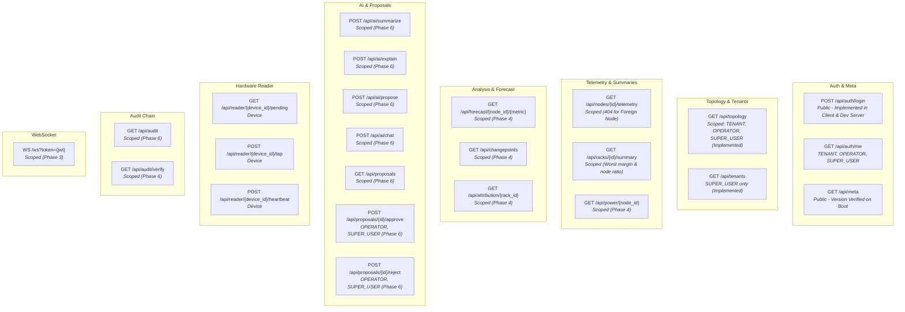
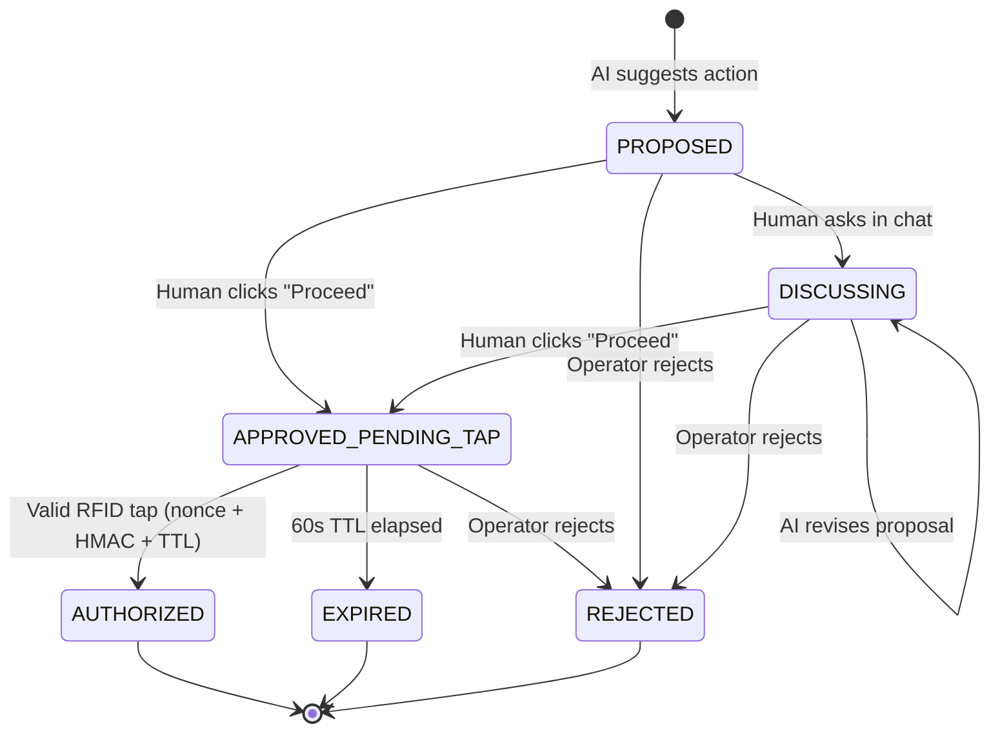

# RackSense — System Graph

_Generated: 2026-10-28T19:12:00Z (Post-Phase 6 Approval, AI Advisory, and Audit Log)_

### 1. Module Graph

```mermaid
graph TD
    subgraph Frontend["frontend/src (Phases 1–6 Complete)"]
        F_TOKENS["design/tokens.css (CSS Variables, .hatch-foreign, .pulse-escalation, .hatch-estimated)"]
        F_PRIMITIVES["design/primitives (Card, Value, StatusBadge, Chip, KpiTile, DataTable, DetailPanel, EmptyState, ErrorState)"]
        F_CONTRACT["api/contract.ts (Closed Enums & Payloads)"]
        F_CLIENT["api/client.ts (Fetch Wrapper & Drift Check)"]
        F_WS["api/ws.ts (Single WebSocket Hook, 500ms Batching Buffer, Stable onChangepoint, Reconnect Backoff, Heartbeat)"]
        F_AUTH["app/authStore.ts (Zustand Auth Store)"]
        F_SHELL["app/Shell.tsx (56px Bar, Live Indicator, Changepoint Toast with Ref Cleanup, Nav, Content)"]
        F_LOGIN["features/auth/LoginPage.tsx"]
        F_HALL["features/hall/RackHallCanvas.tsx (3D WebGL Data Center Hall, 29 Racks, Walking Corridors, Demand Frameloop, Camera Presets, Overhead Infrastructure, CRAC Units)"]
        F_AMBIENT["features/hall/AmbientRack3D.tsx (Enterprise Ambient Server Rack, Plinth, Canopy, Rails, Blade Hardware, Unmonitored Inventory)"]
        F_VMV["features/hall/VisualManagementView.tsx (Industrial DCIM Command Center Layout, TwinThings/IOC Inspired, Full-Page Total View with Floating Side Metrics Dock)"]
        F_TIMELINE["features/hall/ForecastTimelineBar.tsx (Interactive Forecast Scrubber, Live vs ETS Horizon, Auto-Play)"]
        F_OVERVIEW["features/hall/OverviewPanel.tsx (Racks, Nodes, Sensors, Tenants)"]
        F_DONUT["features/hall/ClassificationDonut.tsx (Sensor Distribution Ring Chart)"]
        F_BARS["features/hall/StatisticsBars.tsx (Rack Capacity, Thermal Margin, Power Margin)"]
        F_GAUGES["features/hall/ConsumptionGauges.tsx (PUE, IT Power, Total Power, Empty State)"]
        F_STATUS["features/hall/StatusDistribution.tsx (OK/WARN/CRIT/OFFLINE Stacked Bar & Filter)"]
        F_TRENDS["features/hall/TrendSparkline.tsx (AreaChart Worst-Margin Sparkline)"]
        F_TABS["features/hall/CategoryTabs.tsx (Telemetry Category Filter Chips)"]
        F_RACK3D["features/hall/Rack3D.tsx (Chassis Frame, EIA-310 Rails, Plinth, Canopy, Side Panels, Standby Server Blades, Billboard)"]
        F_SLOT3D["features/hall/Slot3D.tsx (Brushed Steel Chassis, Pull Handles, Hot-Swap Drive Caddies, Status Light Bar, LEDs, Tooltip)"]
        F_HATCH["features/hall/hatchTexture.ts (Canvas 45° Repeating Diagonal Texture)"]
        F_RACK_GRID["features/datacenter/RackGrid.tsx (2D Physical Elevation Fallback, Hatch)"]
        F_RACK_SUMMARY["features/datacenter/RackSummaryCard.tsx (Worst Margin, Nodes Ratio)"]
        F_SLOT_DETAIL["features/topology/SlotDetailPanel.tsx (Sparklines, Honest Provenance, AiPanel Mounted)"]
        F_ISOLATION["features/datacenter/IsolationSplitView.tsx (Dual-Token Live Proof)"]
        F_DC["features/datacenter/DataCenterDashboard.tsx (Visual Management View, Live 3D Hall, Keyboard Rail, Audits, /datacenter/racks Mode)"]
        F_TENANT["features/tenant/TenantDashboard.tsx (Visual Management View, Live 3D Hall, Shielded Foreign Slots, /tenant/racks Mode)"]
        F_ACCESS["features/access/AccessControl.tsx"]
        F_FORECAST["features/forecast/ForecastView.tsx (Capacity & Headroom Analysis Page)"]
        F_CONE["features/forecast/ForecastConeChart.tsx (Recharts ComposedChart, Stat Tile, Table View)"]
        F_VIB["features/forecast/VibrationBaselineChart.tsx (x baseline, 2x WARN / 4x CRIT, Table View)"]
        F_ATTR["features/forecast/TenantAttributionChart.tsx (Horizontal Bars, Basis Strings, Table View)"]
        F_POWER["features/forecast/PowerEstimateChart.tsx (Dedicated Chart, 45° Hatch, Formula Tooltip)"]
        F_SPARKLINE["features/forecast/MetricSparkline.tsx (2px Line, Tabular End Label)"]
        F_AI_PANEL["features/ai/AiPanel.tsx (AI Advisory Assistant, Summarize, Explain, Propose, AI · ADVISORY chip)"]
        F_EVIDENCE["features/ai/EvidenceModal.tsx (Verified Evidence Inspection, fc_ / cp_ / audit proof)"]
        F_PROPOSAL_CARD["features/proposals/ProposalCard.tsx (Action Mapping, Emoji Stripping, Revisions Diff, Audited Chat, Server Countdown, TFT Mirror, Terminal States)"]
        F_STEPPER["features/proposals/ProposalStepper.tsx (Proposed -> Discussing -> Approved, waiting for tap -> Authorized, with Rejected/Expired off-ramps)"]
        F_APPROVALS["features/proposals/ApprovalsView.tsx (Facility Approvals Queue, Status Filtering, Review Side Panel)"]
        F_AUDIT["features/audit/AuditView.tsx (Cryptographic SHA-256 Chain Verification, Tamper Detection, Single-mount Fetch, Data Grid, Mono Hash Copy, Detail Panel)"]
        F_APP["App.tsx (Role-based Routing, Redirection, Mismatch Banner, Approvals, Audit & Racks Sub-route Navigation)"]

        F_PRIMITIVES --> F_CONTRACT
        F_CLIENT --> F_CONTRACT
        F_WS --> F_CONTRACT
        F_WS --> F_CLIENT
        F_AUTH --> F_CLIENT
        F_AUTH --> F_CONTRACT
        F_SHELL --> F_AUTH
        F_SHELL --> F_WS
        F_LOGIN --> F_AUTH
        F_VMV --> F_TIMELINE
        F_VMV --> F_HALL
        F_VMV --> F_OVERVIEW
        F_VMV --> F_DONUT
        F_VMV --> F_BARS
        F_VMV --> F_GAUGES
        F_VMV --> F_STATUS
        F_VMV --> F_TRENDS
        F_VMV --> F_TABS
        F_HALL --> F_RACK3D
        F_HALL --> F_AMBIENT
        F_HALL --> F_RACK_GRID
        F_RACK3D --> F_SLOT3D
        F_SLOT3D --> F_HATCH
        F_RACK_GRID --> F_CONTRACT
        F_RACK_GRID --> F_PRIMITIVES
        F_RACK_SUMMARY --> F_CLIENT
        F_RACK_SUMMARY --> F_CONTRACT
        F_RACK_SUMMARY --> F_PRIMITIVES
        F_SLOT_DETAIL --> F_CLIENT
        F_SLOT_DETAIL --> F_CONTRACT
        F_SLOT_DETAIL --> F_PRIMITIVES
        F_SLOT_DETAIL --> F_SPARKLINE
        F_SLOT_DETAIL --> F_AI_PANEL
        F_ISOLATION --> F_CLIENT
        F_ISOLATION --> F_CONTRACT
        F_ISOLATION --> F_RACK_GRID
        F_DC --> F_VMV
        F_DC --> F_HALL
        F_DC --> F_RACK_SUMMARY
        F_DC --> F_SLOT_DETAIL
        F_DC --> F_ISOLATION
        F_DC --> F_PRIMITIVES
        F_TENANT --> F_VMV
        F_TENANT --> F_HALL
        F_TENANT --> F_RACK_SUMMARY
        F_TENANT --> F_SLOT_DETAIL
        F_TENANT --> F_PRIMITIVES
        F_TENANT --> F_AUTH
        F_ACCESS --> F_PRIMITIVES
        F_FORECAST --> F_CONE
        F_FORECAST --> F_VIB
        F_FORECAST --> F_ATTR
        F_FORECAST --> F_POWER
        F_CONE --> F_PRIMITIVES
        F_VIB --> F_PRIMITIVES
        F_ATTR --> F_PRIMITIVES
        F_POWER --> F_PRIMITIVES
        F_AI_PANEL --> F_PROPOSAL_CARD
        F_AI_PANEL --> F_EVIDENCE
        F_AI_PANEL --> F_CLIENT
        F_AI_PANEL --> F_CONTRACT
        F_PROPOSAL_CARD --> F_STEPPER
        F_PROPOSAL_CARD --> F_EVIDENCE
        F_PROPOSAL_CARD --> F_CLIENT
        F_PROPOSAL_CARD --> F_AUTH
        F_PROPOSAL_CARD --> F_CONTRACT
        F_APPROVALS --> F_PROPOSAL_CARD
        F_APPROVALS --> F_CLIENT
        F_APPROVALS --> F_PRIMITIVES
        F_APPROVALS --> F_CONTRACT
        F_AUDIT --> F_CLIENT
        F_AUDIT --> F_PRIMITIVES
        F_AUDIT --> F_CONTRACT
        F_APP --> F_AUTH
        F_APP --> F_CLIENT
        F_APP --> F_SHELL
        F_APP --> F_LOGIN
        F_APP --> F_DC
        F_APP --> F_TENANT
        F_APP --> F_ACCESS
        F_APP --> F_FORECAST
        F_APP --> F_APPROVALS
        F_APP --> F_AUDIT
    end

    subgraph Backend["backend/ (PLANNED)"]
        B_API["api/ (FastAPI Routes)"]
        B_SRV["services/ (logic)"]
        B_REPO["repos/ (queries, scope.py)"]
        B_DB["db/ (sqlite wal)"]

        B_API -.->|PLANNED| B_SRV
        B_SRV -.->|PLANNED| B_REPO
        B_REPO -.->|PLANNED| B_DB
    end

    subgraph Firmware["firmware/ (PLANNED)"]
        FW_ENV["esp32-env (r1-n1)"]
        FW_VIB["esp32s3-vib (r2-n1)"]
        FW_AUTH["esp32s3-auth (reader-01)"]
    end

    F_CLIENT -.->|REST /api/auth, /api/topology, /api/forecast, /api/ai, /api/proposals, /api/audit| B_API
```



### 2. Data-Flow Graph

```mermaid
graph LR
    subgraph Sensing
        DHT["DHT22 / MQ135 / SW-420"]
        MPU["MPU6050"]
        RFID["RC522 + TFT"]
    end

    subgraph MQTT["MQTT Broker (Mosquitto)"]
        TOPIC_ENV["dc/site-01/rack-01/r1-n1/telemetry"]
        TOPIC_VIB["dc/site-01/rack-02/r2-n1/telemetry"]
        TOPIC_STATUS["dc/site-01/+/+/status"]
    end

    subgraph IngestStore["Ingest & Storage (Backend)"]
        INGEST["Ingest Service"]
        DB[(SQLite WAL)]
    end

    subgraph Analysis["Edge Analysis"]
        FC["ETS Forecaster"]
        CP["CUSUM + PELT"]
        ATTR["Attribution"]
        PWR["Power Estimator"]
        AUDIT["Audit Hash Chain"]
    end

    subgraph Delivery["API & Realtime"]
        FASTAPI["FastAPI Routes"]
        WS["WebSocket Server"]
    end

    subgraph UI["Frontend UI (Phases 1–6 Built)"]
        UI_AUTH["LoginPage"]
        UI_SHELL["App Shell (56px bar, nav)"]
        UI_DC["Data Center Dashboard (Rack list, 3D Hall, Summary)"]
        UI_TENANT["Tenant Dashboard (Hatched Foreign Slots, 'Not your slot')"]
        UI_SLOT_DETAIL["SlotDetailPanel (Honest Provenance, Warming Up, 404, AiPanel)"]
        UI_ISOLATION["IsolationSplitView (Live Dual-Token Request Proof)"]
        UI_FORECAST["ForecastView (Capacity Analysis, Cone, Baseline, Attribution)"]
        UI_APPROVALS["ApprovalsView (Action Approvals Queue)"]
        UI_AUDIT["AuditView (Cryptographic SHA-256 Chain Verification, Tamper Detection)"]
        UI_PROPOSAL["ProposalCard (Pre-Approval Chat, Step-by-Step, Countdown)"]
    end

    DHT -.->|MQTT QoS 0 (PLANNED)| TOPIC_ENV
    MPU -.->|MQTT QoS 0 (PLANNED)| TOPIC_VIB
    DHT -.->|LWT (PLANNED)| TOPIC_STATUS

    TOPIC_ENV -.->|PLANNED| INGEST
    TOPIC_VIB -.->|PLANNED| INGEST
    TOPIC_STATUS -.->|PLANNED| INGEST
    INGEST -.->|PLANNED| DB

    DB -.->|PLANNED| FC
    DB -.->|PLANNED| CP
    DB -.->|PLANNED| ATTR
    DB -.->|PLANNED| PWR
    INGEST -.->|PLANNED| AUDIT

    FC -.->|PLANNED| FASTAPI
    CP -.->|PLANNED| FASTAPI
    ATTR -.->|PLANNED| FASTAPI
    PWR -.->|PLANNED| FASTAPI
    AUDIT -.->|PLANNED| FASTAPI

    INGEST -.->|PLANNED| WS
    RFID -.->|HTTP Tap / Nonce (PLANNED)| FASTAPI

    FASTAPI -.->|REST / Client| UI_AUTH
    FASTAPI -.->|REST / Client| UI_DC
    FASTAPI -.->|REST / Client| UI_TENANT
    FASTAPI -.->|REST / Client| UI_ISOLATION
    FASTAPI -.->|REST / Client| UI_SLOT_DETAIL
    FASTAPI -.->|REST / Client| UI_FORECAST
    FASTAPI -.->|REST / Client| UI_APPROVALS
    FASTAPI -.->|REST / Client| UI_AUDIT
    UI_APPROVALS --> UI_PROPOSAL
    UI_SLOT_DETAIL --> UI_PROPOSAL
```

### 3. API Surface Map



### 4. Proposal State Machine



### Subsystem Status

| Subsystem | Status | Where it lives | Notes |
|---|---|---|---|
| Ingest | Not started | `backend/services/ingest.py` (planned) | Mosquitto broker + MQTT subscriber |
| Storage | Not started | `backend/db/` (planned) | SQLite in WAL mode |
| Forecast | Not started | `backend/services/forecast.py` (planned) | ETS damped + 1000 Monte Carlo paths |
| Change-point | Not started | `backend/services/changepoint.py` (planned) | CUSUM trigger + PELT confirmation |
| Attribution | Not started | `backend/services/attribution.py` (planned) | Inferred temporal correlation |
| Power | Not started | `backend/services/power.py` (planned) | Fan et al. CPU-utilization linear model |
| AI | Implemented (Frontend UI & dev server) | `frontend/src/features/ai/` | Advisory only, closed whitelist, AI · ADVISORY chip |
| Approval | Implemented (Frontend UI & dev server) | `frontend/src/features/proposals/` | Server state machine, single-use 60s nonce, RFID mirror |
| Audit | Implemented (Frontend UI & dev server) | `frontend/src/features/audit/` | Append-only SHA-256 hash chain verification, tamper detection |
| Frontend | Complete (Phases 1–6) | `frontend/` | All 6 phases complete (88 unit/integration tests passing) |
| Firmware | Not started | `firmware/` (planned) | ESP32 env, ESP32-S3 vib, ESP32-S3 auth |
