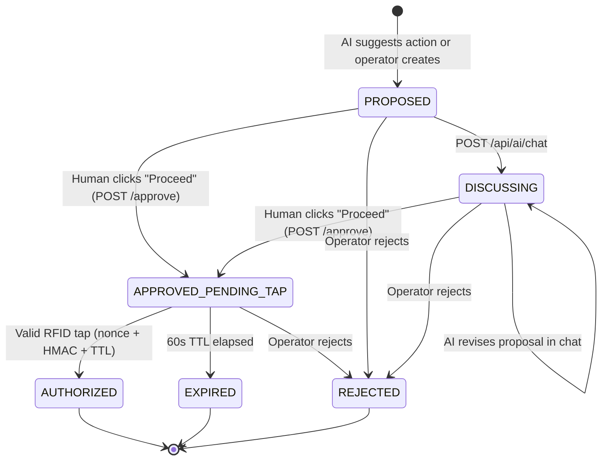

# RackSense — System Graph

_Generated: 2026-10-28T19:54:00Z (Full-Stack System: Backend Phases A–F + Frontend Phases 1–6 Complete)_

### 1. Full-Stack Module Graph

```mermaid
graph TD
    classDef done fill:#d4edda,stroke:#28a745,stroke-width:2px;

    subgraph Hardware["hardware/ (Firmware Shipped in Kit)"]
        H_ENV["hardware/node_env_esp32 (ESP32 Dev Module)"]:::done
        H_VIB["hardware/node_vib_esp32s3 (ESP32-S3 #2)"]:::done
        H_AUTH["hardware/auth_console_esp32s3 (ESP32-S3 #1)"]:::done
    end

    subgraph Backend["backend/ (Phases A–F Complete)"]
        B_INGEST["backend/ingest (validator, normaliser, subscriber)"]:::done
        B_DB["backend/db (SQLite WAL, connection)"]:::done
        B_REPOS["backend/repos (nodes, telemetry, topology, users, audit, analysis, baselines, proposals, readers)"]:::done
        B_SCOPE["backend/repos/scope.py (apply_scope single choke point)"]:::done
        B_AUDIT["backend/services/audit.py (SHA-256 hash chain, verify)"]:::done
        B_ANALYSIS["backend/services (forecast, changepoint, attribution, power, scheduler)"]:::done
        B_APPROVAL["backend/services/approval.py (RFID nonce, HMAC, atomic consume)"]:::done
        B_AI["backend/services/ai (RAG, client, summarizer, explainer, proposer, chat)"]:::done
        B_BROADCAST["backend/services/broadcaster.py (RealtimeBroadcaster, 500ms batching, backpressure)"]:::done
        B_LIMIT["backend/core/ratelimit.py (sliding window limiter)"]:::done
        B_API["backend/api (auth, meta, ws, topology, telemetry, racks, audit, analysis, proposals, reader, ai)"]:::done
    end

    subgraph Frontend["frontend/src (Phases 1–6 Complete)"]
        F_TOKENS["design/tokens.css (CSS Variables, .hatch-foreign, .pulse-escalation)"]:::done
        F_PRIMITIVES["design/primitives (Card, Value, StatusBadge, Chip, KpiTile, DataTable, DetailPanel, EmptyState, ErrorState)"]:::done
        F_CONTRACT["api/contract.ts (Closed Enums & Payloads)"]:::done
        F_CLIENT["api/client.ts (Fetch Wrapper & Drift Check)"]:::done
        F_WS["api/ws.ts (Single WebSocket Hook, 500ms Batching Buffer, Reconnect Backoff, Heartbeat)"]:::done
        F_AUTH["app/authStore.ts (Zustand Auth Store)"]:::done
        F_SHELL["app/Shell.tsx (56px Bar, Live Indicator, Changepoint Toast, Nav, Content)"]:::done
        F_HALL["features/hall/RackHallCanvas.tsx (3D WebGL Hall, Demand Frameloop, Orbit, WebGL Fallback)"]:::done
        F_DC["features/datacenter/DataCenterDashboard.tsx (Live 3D Hall, Keyboard Rail, Audits)"]:::done
        F_TENANT["features/tenant/TenantDashboard.tsx (Live 3D Hall, Shielded Foreign Slots)"]:::done
        F_FORECAST["features/forecast/ForecastView.tsx (Capacity & Headroom Analysis Page)"]:::done
        F_CONE["features/forecast/ForecastConeChart.tsx (Recharts ComposedChart, Stat Tile, Table View)"]:::done
        F_AI["features/ai/AiPanel.tsx (AI Advisory Assistant, Summarize, Explain, Propose, AI · ADVISORY chip)"]:::done
        F_PROPOSAL["features/proposals/ProposalCard.tsx (Action Mapping, Revisions Diff, Audited Chat, Server Countdown, TFT Mirror)"]:::done
        F_APPROVALS["features/proposals/ApprovalsView.tsx (Facility Approvals Queue, Status Filtering)"]:::done
        F_AUDIT_VIEW["features/audit/AuditView.tsx (Cryptographic SHA-256 Chain Verification, Tamper Detection, Data Grid)"]:::done
        F_APP["App.tsx (Role-based Routing, Redirection, Mismatch Banner)"]:::done
    end

    H_ENV -. MQTT .-> B_INGEST
    H_VIB -. MQTT .-> B_INGEST
    H_AUTH -. HTTP REST & HMAC .-> B_API
    B_INGEST --> B_DB
    B_INGEST --> B_AUDIT
    B_INGEST --> B_BROADCAST
    B_DB --> B_REPOS
    B_REPOS --> B_SCOPE
    B_SCOPE --> B_API
    B_REPOS --> B_ANALYSIS
    B_ANALYSIS --> B_REPOS
    B_ANALYSIS --> B_BROADCAST
    B_API --> B_APPROVAL
    B_APPROVAL --> B_REPOS
    B_APPROVAL --> B_AUDIT
    B_APPROVAL --> B_BROADCAST
    B_API --> B_AI
    B_AI --> B_REPOS
    B_AI --> B_AUDIT
    B_API --> B_BROADCAST
    B_API --> B_LIMIT

    B_BROADCAST -. WS Stream .-> F_WS
    B_API -. REST .-> F_CLIENT
    F_CLIENT --> F_APP
    F_WS --> F_SHELL
```

### 2. Proposal State Machine (Server-Owned, Human-Gated)

### 3. API Surface Map

| Route | Method | Roles | Implementation State |
|---|---|---|---|
| `/api/meta` | GET | Public | Backend implemented · Frontend verified on boot |
| `/api/health` | GET | Public | Backend implemented (subsystem health & audit chain) |
| `/ws` | WS | Authenticated (JWT token param) | Backend implemented · Frontend single hook with 500ms buffer |
| `/api/auth/login` | POST | Public | Backend implemented (rate-limited) · Frontend LoginPage |
| `/api/auth/me` | GET | TENANT, OPERATOR, SUPER_USER | Backend implemented · Frontend authStore |
| `/api/topology` | GET | TENANT (redacted), OPERATOR, SUPER_USER | Backend implemented · Frontend 3D Hall & 2D Grid |
| `/api/nodes/{node_id}/telemetry` | GET | TENANT (scoped), OPERATOR, SUPER_USER | Backend implemented · Frontend SlotDetailPanel sparklines |
| `/api/racks/{rack_id}/summary` | GET | TENANT (scoped), OPERATOR, SUPER_USER | Backend implemented · Frontend RackSummaryCard |
| `/api/audit` | GET | TENANT (scoped), OPERATOR, SUPER_USER | Backend implemented · Frontend AuditView data grid |
| `/api/audit/verify` | GET | TENANT, OPERATOR, SUPER_USER | Backend implemented · Frontend cryptographic verification hero |
| `/api/tenants` | GET | SUPER_USER only (others get 404) | Backend implemented · Frontend AccessControl |
| `/api/forecast/{node_id}/{metric}` | GET | TENANT (scoped), OPERATOR, SUPER_USER | Backend implemented · Frontend ForecastConeChart |
| `/api/changepoints` | GET | TENANT (scoped), OPERATOR, SUPER_USER | Backend implemented · Frontend toast & timeline |
| `/api/attribution/{rack_id}` | GET | TENANT (scoped), OPERATOR, SUPER_USER | Backend implemented · Frontend TenantAttributionChart |
| `/api/power/{node_id}` | GET | TENANT (scoped), OPERATOR, SUPER_USER | Backend implemented · Frontend PowerEstimateChart |
| `/api/baselines/{node_id}/{metric}/capture` | POST | OPERATOR, SUPER_USER | Backend implemented |
| `/api/proposals` | POST / GET | Scoped | Backend implemented · Frontend ApprovalsView |
| `/api/proposals/{proposal_id}` | GET | Scoped | Backend implemented · Frontend ProposalCard |
| `/api/proposals/{proposal_id}/approve` | POST | OPERATOR, SUPER_USER | Backend implemented (60s nonce) · Frontend Proceed button |
| `/api/proposals/{proposal_id}/reject` | POST | OPERATOR, SUPER_USER | Backend implemented · Frontend Reject button |
| `/api/reader/{device_id}/pending` | GET | Public (Device) | Backend implemented · Hardware reader console |
| `/api/reader/{device_id}/tap` | POST | Public (Device HMAC) | Backend implemented · Hardware reader console |
| `/api/reader/{device_id}/heartbeat` | POST | Public (Device) | Backend implemented · Hardware reader console |
| `/api/ai/summarize` | POST | Scoped | Backend implemented · Frontend AiPanel |
| `/api/ai/explain` | POST | Scoped | Backend implemented · Frontend AiPanel |
| `/api/ai/propose` | POST | Scoped | Backend implemented · Frontend AiPanel |
| `/api/ai/chat` | POST | Scoped | Backend implemented · Frontend ProposalCard discussion thread |

### 4. Subsystem Status

| Subsystem | Status | Where it lives | Notes |
|---|---|---|---|
| Ingest | Implemented | `backend/ingest/` | Subscriber, validation, normalisation, LWT, gap detection |
| Storage | Implemented | `backend/db/`, `backend/repos/` | SQLite WAL, telemetry, nodes, topology, users, cards, forecast_cache, changepoints, baselines, proposals, nonces, reader_devices |
| Auth & Isolation | Implemented | `backend/repos/scope.py`, `backend/api/deps.py` | Single choke point, JWT, Scope object, 404 isolation, denial auditing |
| Forecast | Implemented | `backend/services/forecast.py` | Theil-Sen slope CI check, ETS damped trend, 1000 sims, P10/P50/P90, no_breach_fraction |
| Change-point | Implemented | `backend/services/changepoint.py` | Dual detector: CUSUM trigger + ruptures PELT confirmation, topology correlation |
| Attribution | Implemented | `backend/services/attribution.py` | Inferred tenant contribution with basis string |
| Power | Implemented | `backend/services/power.py` | Linear CPU model, estimated quality, complete model_detail |
| Anomaly | Implemented | `backend/services/anomaly.py` | IsolationForest baseline scoring |
| Scheduler | Implemented | `backend/services/scheduler.py` | Async task recomputing every 10s into cache tables, reaps expired nonces |
| Approval | Implemented | `backend/services/approval.py` | Server state machine, 60s single-use nonce, HMAC validation, atomic rowcount==1 consume |
| AI | Implemented | `backend/services/ai/`, `backend/api/ai.py` | Advisory only, OWASP LLM06, closed whitelist, evidence grounding, scoped RAG |
| Realtime & Broadcaster | Implemented | `backend/services/broadcaster.py`, `backend/api/ws.py` | 500ms per-node batching, prioritized queue backpressure, double-check scope |
| Hardening & Limiting | Implemented | `backend/core/ratelimit.py`, `backend/api/meta.py` | Sliding window rate limiter, startup self-check fails loud on broken audit |
| Audit | Implemented | `backend/services/audit.py`, `backend/repos/audit.py` | Append-only SHA-256 hash chain, zero UPDATE/DELETE, GET /api/audit/verify |
| Frontend | Implemented | `frontend/` | Complete 6 phases: 3D hall, forecast cones, approval loop, audit tamper UI (88 tests passing) |
| Firmware | Implemented | `hardware/` | Shipped in kit |
