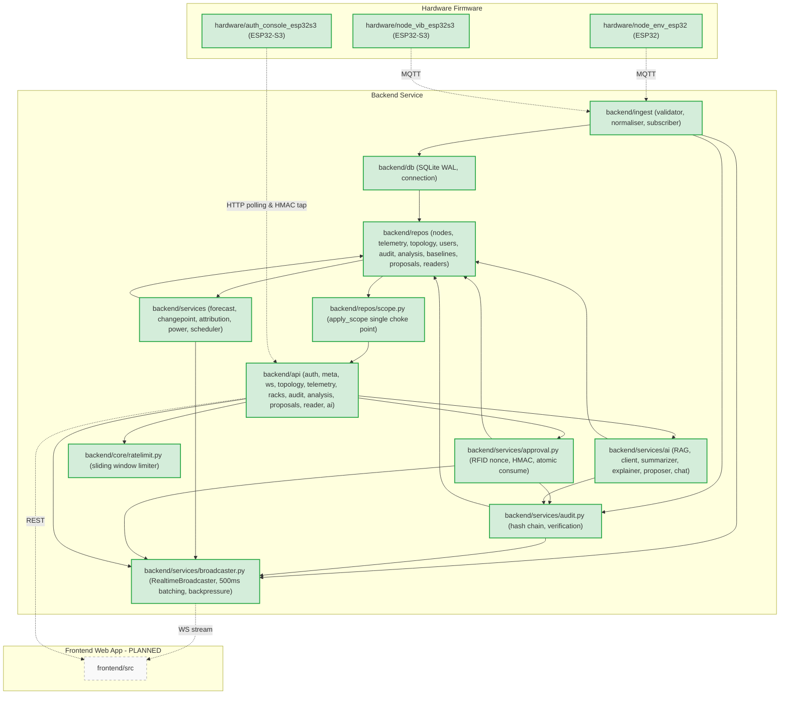
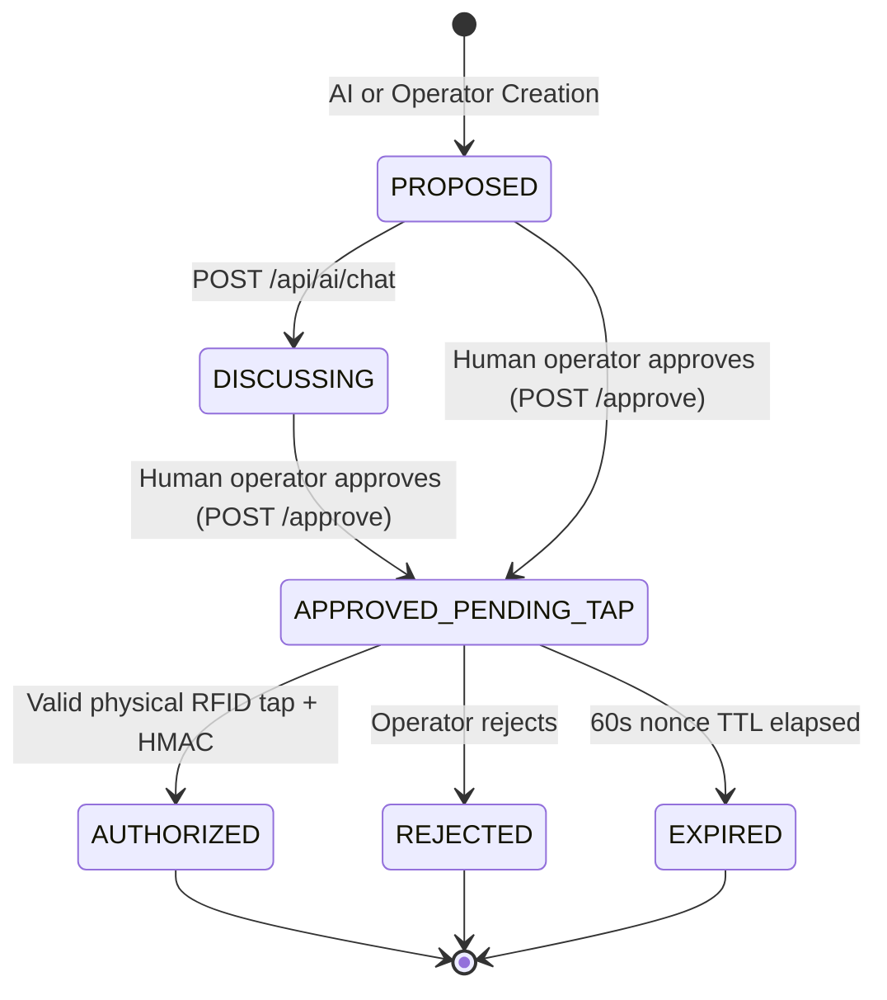

# System Graph

Visual map of the current RackSense implementation state.
Generated on 2026-10-28 (Post Phase F: Realtime Telemetry, Timing & Operational Hardening).

## 1. Module Graph



## 2. Data-Flow Graph

```mermaid
flowchart TD
    classDef planned fill:#f9f9f9,stroke:#999,stroke-dasharray: 5 5;
    classDef done fill:#d4edda,stroke:#28a745,stroke-width:2px;

    SENSORS["ESP32 Nodes"]:::done -->|MQTT| INGEST["MQTT Ingest Pipeline"]:::done
    INGEST -->|Write| DB[("SQLite WAL")]:::done

    SCHED["AnalysisScheduler (every 10s)"]:::done
    DB --> SCHED
    SCHED -->|TheilSen + ETS + 1000 Sims| FC["Forecast Engine"]:::done
    SCHED -->|CUSUM + PELT| CP["Change Point Detector"]:::done
    SCHED -->|Slot + Correlation| ATTR["Attribution Engine"]:::done
    SCHED -->|Linear CPU Model| PWR["Power Estimator"]:::done
    SCHED -->|Reaper| REAP["Nonce Expiry Reaper"]:::done

    FC -->|Cache| CACHE_FC[("forecast_cache table")]:::done
    CP -->|Log| TABLE_CP[("changepoints table")]:::done

    subgraph AI_LAYER [AI Advisory Layer (OWASP LLM06)]
        AI_SUMM["POST /api/ai/summarize"]:::done
        AI_EXPL["POST /api/ai/explain"]:::done
        AI_PROP["POST /api/ai/propose"]:::done
        AI_CHAT["POST /api/ai/chat"]:::done
        RUNBOOK[("shared/runbook.md + Incidents")]:::done
    end

    CACHE_FC --> AI_EXPL
    DB --> AI_SUMM
    RUNBOOK -->|Scope-First RAG| AI_LAYER
    AI_PROP -->|Create PROPOSED| DB

    subgraph API [FastAPI Scoped Endpoints]
        API_PROP["POST /api/proposals/{id}/approve"]:::done
        API_TAP["POST /api/reader/{device}/tap"]:::done
        API_PEND["GET /api/reader/{device}/pending"]:::done
        API_VERIFY["GET /api/audit/verify"]:::done
    end

    API_PROP -->|Issue Nonce TTL 60s| DB
    API_PEND -->|Pre-rendered ASCII TFT| TFT["Physical Auth Console TFT"]:::done
    TFT -->|Physical RFID Tap + HMAC-SHA256| API_TAP
    API_TAP -->|Atomic UPDATE & Audit Hash| DB
    API_VERIFY -->|Verify SHA-256 Chain| AUDIT_CHAIN[("audit table")]:::done
```

## 3. API Surface Map

Routes defined in code vs `shared/api-contract.md`:

| Route | Method | Roles | Status |
|---|---|---|---|
| `/api/meta` | GET | Public | Implemented |
| `/api/health` | GET | Public | Implemented (subsystem health & audit integrity) |
| `/ws` | WS | Authenticated (JWT token param) | Implemented (500ms batching, double scope) |
| `/api/auth/login` | POST | Public | Implemented (sliding-window rate-limited) |
| `/api/auth/me` | GET | TENANT, OPERATOR, SUPER_USER | Implemented |
| `/api/topology` | GET | TENANT (redacted), OPERATOR, SUPER_USER | Implemented |
| `/api/nodes/{node_id}/telemetry` | GET | TENANT (scoped), OPERATOR, SUPER_USER | Implemented |
| `/api/racks/{rack_id}/summary` | GET | TENANT (scoped), OPERATOR, SUPER_USER | Implemented (real worst_margin) |
| `/api/audit` | GET | TENANT (scoped), OPERATOR, SUPER_USER | Implemented |
| `/api/audit/verify` | GET | TENANT, OPERATOR, SUPER_USER | Implemented (recomputes full chain) |
| `/api/tenants` | GET | SUPER_USER only (others get 404) | Implemented |
| `/api/forecast/{node_id}/{metric}` | GET | TENANT (scoped), OPERATOR, SUPER_USER | Implemented |
| `/api/changepoints` | GET | TENANT (scoped), OPERATOR, SUPER_USER | Implemented |
| `/api/attribution/{rack_id}` | GET | TENANT (scoped), OPERATOR, SUPER_USER | Implemented |
| `/api/power/{node_id}` | GET | TENANT (scoped), OPERATOR, SUPER_USER | Implemented |
| `/api/baselines/{node_id}/{metric}/capture` | POST | OPERATOR, SUPER_USER | Implemented |
| `/api/proposals` | POST | OPERATOR, SUPER_USER | Implemented |
| `/api/proposals` | GET | TENANT (scoped), OPERATOR, SUPER_USER | Implemented |
| `/api/proposals/{proposal_id}` | GET | TENANT (scoped), OPERATOR, SUPER_USER | Implemented |
| `/api/proposals/{proposal_id}/approve` | POST | OPERATOR, SUPER_USER (TENANT gets 404) | Implemented (issues 60s nonce) |
| `/api/proposals/{proposal_id}/reject` | POST | OPERATOR, SUPER_USER | Implemented |
| `/api/reader/{device_id}/pending` | GET | Public (Device) | Implemented (pre-rendered ASCII lines) |
| `/api/reader/{device_id}/tap` | POST | Public (Device HMAC) | Implemented (6-step atomic check, rate-limited) |
| `/api/reader/{device_id}/heartbeat` | POST | Public (Device) | Implemented (NTP server time) |
| `/api/ai/summarize` | POST | TENANT (scoped), OPERATOR, SUPER_USER | Implemented (evidence grounded) |
| `/api/ai/explain` | POST | TENANT (scoped), OPERATOR, SUPER_USER | Implemented (real parameters) |
| `/api/ai/propose` | POST | TENANT (scoped), OPERATOR, SUPER_USER | Implemented (closed whitelist) |
| `/api/ai/chat` | POST | TENANT (scoped), OPERATOR, SUPER_USER | Implemented (prompt-injection hardened) |

*Contract drift: None.*

## 4. Proposal State Machine (Server-Owned)



## Subsystem Status

| Subsystem | Status | Where it lives | Notes |
|---|---|---|---|
| Ingest | Implemented | `backend/ingest/` | Subscriber, validation, normalisation, LWT, gap detection |
| Storage | Implemented | `backend/db/`, `backend/repos/` | SQLite WAL, telemetry, nodes, topology, users, cards, forecast_cache, changepoints, baselines, proposals, nonces, reader_devices |
| Auth & Isolation | Implemented | `backend/repos/scope.py`, `backend/api/deps.py` | Single choke point, JWT, Scope object, 404 isolation, denial auditing |
| Forecast | Implemented | `backend/services/forecast.py` | Theil-Sen slope CI check, ETS damped trend, 1000 sims, P10/P50/P90, no_breach_fraction |
| Change-point | Implemented | `backend/services/changepoint.py` | Dual detector: CUSUM trigger + ruptures PELT confirmation, topology correlation |
| Attribution | Implemented | `backend/services/attribution.py` | Inferred tenant contribution with basis string |
| Power | Implemented | `backend/services/power.py` | Linear CPU model, estimated quality, complete model_detail |
| Anomaly | Implemented | `backend/services/anomaly.py` | IsolationForest baseline scoring |
| Scheduler | Implemented | `backend/services/scheduler.py` | Async task recomputing every 10s into cache tables, reaps expired nonces |
| Approval | Implemented | `backend/services/approval.py` | Single-use 60s nonce, 6-step validation, HMAC-SHA256, atomic rowcount==1 consume |
| AI | Implemented | `backend/services/ai/`, `backend/api/ai.py` | Advisory only, OWASP LLM06, closed whitelist, evidence grounding, scoped RAG |
| Realtime & Broadcaster | Implemented | `backend/services/broadcaster.py`, `backend/api/ws.py` | 500ms per-node batching, prioritized queue backpressure, double-check scope |
| Hardening & Limiting | Implemented | `backend/core/ratelimit.py`, `backend/api/meta.py` | Sliding window rate limiter, startup self-check fails loud on broken audit |
| Audit | Implemented | `backend/services/audit.py`, `backend/repos/audit.py` | Append-only SHA-256 hash chain, zero UPDATE/DELETE, GET /api/audit/verify |
| Frontend | Not started | `frontend/` | Phase 1-6 target |
| Firmware | Implemented | `hardware/` | Shipped in kit |
